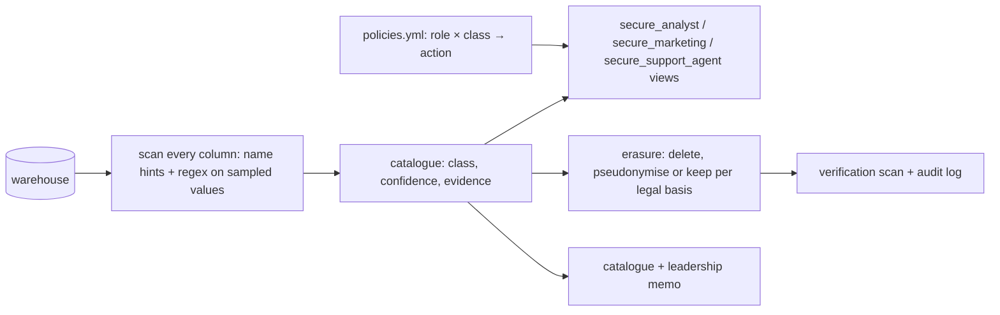

# Data Governance & Privacy

[](https://github.com/Saigwe/data-governance-privacy/actions/workflows/ci.yml)
 

> **Headline:** an automated scan found personal data in **8 columns, including 2 places nobody had documented** (free-text support tickets and a marketing contact field). Analysts now see pseudonymised data by default, and a GDPR erasure request is completed and verified in milliseconds, with an audit record.

Governance that runs as code, not as a policy PDF: discover where personal data lives, classify it, enforce who can see what through generated secure views, and handle the right to erasure end to end, including the places a simple `customer_id` join would miss.

## What it does



| Capability | How |
|---|---|
| **Discovery & classification** | Every column is classified as `pii_direct`, `pii_quasi`, `financial`, `pii_free_text`, `identifier` or `none`, from its name **and** a sample of its values. That's how emails hidden inside ticket text are found. 20/20 correct against a hand-labelled list. |
| **Role-based masking** | [`policies.yml`](policies.yml) maps each role and class to an action: clear, mask, hash, generalise, redact or deny. 12 secure views are generated from it. Analysts get stable hashes (joins still work), birth years instead of birth dates, ticket text with `[email]`/`[phone]` redacted, and no IBANs. |
| **Right to erasure (GDPR Art. 17)** | Deletes the customer, their tickets and their marketing events (matched by email, found through classification), and keeps order amounts under a pseudonym because financial records must be retained. A verification scan confirms nothing identifying remains, and the request is logged. |
| **Catalogue & retention** | [`output/data_catalog.md`](output/data_catalog.md) lists every column's class and evidence, plus retention periods |

The memo for leadership is [`output/governance_memo.md`](output/governance_memo.md), with findings, what each role now sees, the erasure audit and three asks.

## Run it

```bash
pip install -r requirements.txt
python -m governance.run
pytest
```

The tests check:
- classification against ground truth
- that the analyst views contain no raw emails or phone numbers and no IBAN column
- that pseudonymised keys still join
- that erasure removes everything except legally retained, pseudonymised records

## Walkthrough

- [ ] 3-minute Loom walkthrough ([script ready](docs/walkthrough.md))

## Stack

Python, DuckDB (secure views, regex redaction, md5 pseudonyms), YAML policy-as-code, pytest.
